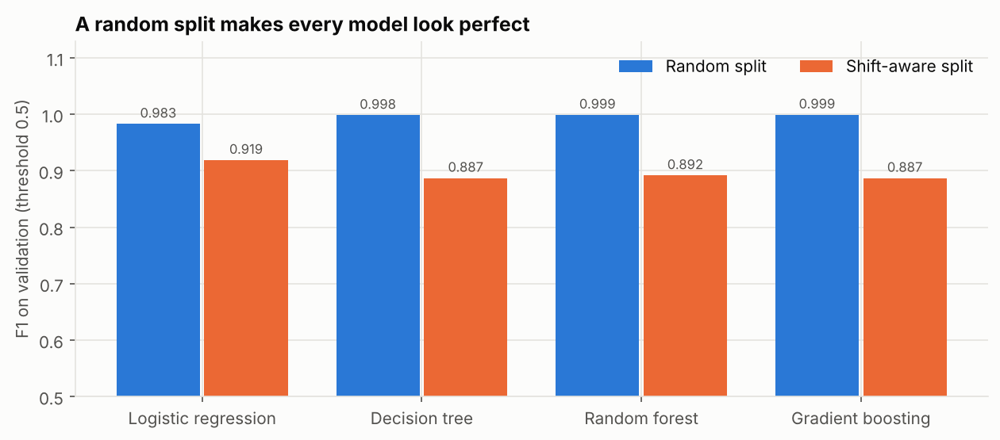
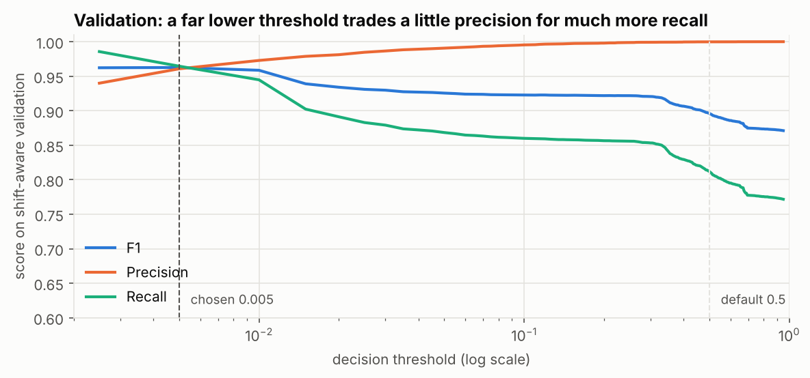
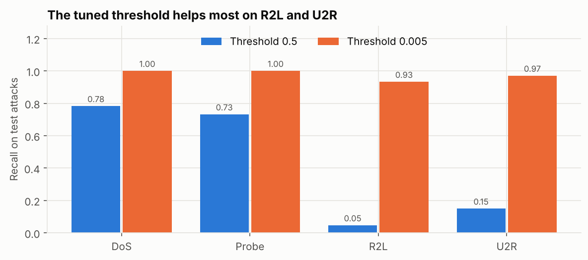

# Network Intrusion Detection: an End-to-End ML Pipeline on NSL-KDD

A machine learning pipeline that flags malicious network connections, built and tuned for the condition that matters most in intrusion detection: **attacks the model has never seen before**.

Portfolio project for the Codecademy Machine Learning/AI Engineer career path.

## Headline result

On the official NSL-KDD test file (22,544 connections, 29% of the attacks belong to types that never appear in training):

| Model | Accuracy | Precision | Recall | F1 | False alarm rate |
|---|---|---|---|---|---|
| Tuned random forest, default threshold (0.5) | 0.763 | 0.967 | 0.604 | 0.744 | 0.027 |
| Tuned random forest, tuned threshold (0.005) | **0.924** | 0.892 | **0.985** | **0.936** | 0.157 |

Same model, same features. The only change is a decision threshold chosen on a validation set designed to contain unseen attacks.

## The problem with the obvious approach

A standard random train/validation split makes every model look nearly perfect, because the validation set contains the same attack types the model trained on. The test file is different: 17 of its attack types (for example `mscan`, `apache2`, `snmpguess`, `processtable`) never appear in training.



## What I did about it

1. **Shift-aware validation.** Eight attack types (one to three per attack family) are withheld from training and placed only in the validation set. Validation scores then measure what the test file measures: how the model copes with new attacks. The withheld types are fixed in code before the test file is touched.
2. **Hyperparameter search against that target.** `RandomizedSearchCV` with a `PredefinedSplit` scores every candidate on the shift-aware validation set, using average precision.
3. **Threshold tuning.** A random forest's probability is the share of trees voting "attack". Unseen attacks only convince a few trees, so the best threshold is far below 0.5. It is chosen to maximise F1 on the shift-aware validation set, and a second, disjoint set of withheld attacks confirms the direction (section 7.1 of the notebook).
4. **One deployable object.** Preprocessing, the tuned forest and the threshold are wrapped in a single scikit-learn `FixedThresholdClassifier`, saved with `joblib`.





## The trade-off

The tuned threshold catches far more attacks, but it also flags more normal traffic (false alarm rate in the table above). For a real security team the threshold should be set against an alert budget, not F1 alone. The notebook exposes the trade-off rather than hiding it.

## Pipeline

```
raw connection record
  └─ ColumnTransformer
       ├─ categorical (protocol_type, service, flag): most-frequent impute → one-hot
       ├─ skewed counters (bytes, counts, file/root activity): median impute → log1p → standard scale
       └─ other numeric (rates, flags): median impute → standard scale
  └─ RandomForestClassifier (300 trees, max_depth 20, max_features sqrt)
  └─ FixedThresholdClassifier (threshold 0.005)
       → is_attack
```

## Repository layout

```
├── data/
│   └── download_data.py        # fetches KDDTrain+ / KDDTest+ into data/raw/
├── notebooks/
│   └── nids_ml_pipeline.ipynb  # full workflow: ETL → EDA → features → models → tuning → evaluation
├── reports/
│   ├── figures/                # charts used in the notebook and this README
│   └── model_config.json       # tuned hyperparameters and threshold
├── src/
│   └── nids_pipeline.py        # ETL, feature lists, pipeline builder, validation split
├── train.py                    # rebuilds and saves the final model without the notebook
├── predict.py                  # scores a CSV of connections with the saved model
└── requirements.txt
```

## How to run

```bash
python -m venv .venv && source .venv/bin/activate
pip install -r requirements.txt
python data/download_data.py       # ~22 MB

# Option A: the full analysis
jupyter notebook notebooks/nids_ml_pipeline.ipynb

# Option B: just rebuild the model and print test metrics
python train.py

# Score new records (CSV with the NSL-KDD feature columns as a header)
python predict.py my_connections.csv
```

The notebook takes about 5 minutes on a laptop; most of that is the hyperparameter search.

## Limitations

- NSL-KDD is synthetic traffic from 1998. It is a standard benchmark, not a picture of a modern network, so these numbers will not transfer directly to live traffic.
- The best threshold depends on which attack types are withheld for validation (0.005 with the primary set, 0.025 with the alternative set). It should be re-tuned as the attack mix changes.
- The model says whether a connection is an attack, not which kind.

## Next steps

- Validate on a modern dataset such as CIC-IDS2017 or UNSW-NB15.
- Add an anomaly detector trained on normal traffic only (for example an isolation forest) to catch attacks unlike anything labelled.
- Move to multi-class output so alerts carry the attack family.
- Calibrate probabilities and set the threshold from a target false alarm rate.
- Serve the saved pipeline behind a small API and monitor input drift.

## Data

NSL-KDD, Canadian Institute for Cybersecurity, University of New Brunswick. Tavallaee, M., Bagheri, E., Lu, W. and Ghorbani, A. A. (2009) "A Detailed Analysis of the KDD CUP 99 Data Set", *IEEE Symposium on Computational Intelligence for Security and Defense Applications*.
